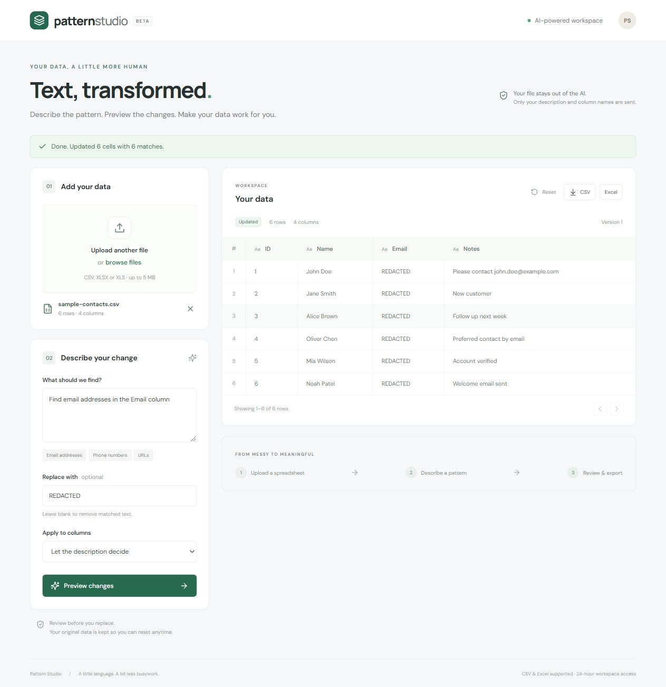

# Pattern Studio

A Django + React application that turns plain-language descriptions into regular expressions, previews replacements, and exports cleaned CSV or Excel data.

**Source:** [Daniel-Eley/pattern-studio](https://github.com/Daniel-Eley/pattern-studio)

**Live app:** [Open Pattern Studio](https://pattern-studio-gp75.onrender.com/)

**Submission status:** Source and the public app are published. Live Groq and production upload → preview → apply → CSV/XLSX export → reset were verified on 3 November 2026. All 14 backend tests pass. The demo video remains to be recorded and embedded.



## Features

- Upload UTF-8 CSV, XLSX, or XLS; view data in pages of 100 rows.
- Describe a pattern (for example, “Find email addresses in the Email column”).
- Generate a structured regex plan with Groq (free tier) or the optional OpenAI provider; view the regex, explanation, match count, and before/after cells.
- Override the target column, supply a literal replacement, or leave it blank to remove matches.
- Describe row conditions, such as “All board numbers with course SWEN90014”. The preview shows the target columns, row-filter regexes, and eligible-row count. Filters are evaluated against the original row before modifying cells.
- Apply only after preview, reset to the original data, and download CSV or XLSX.
- Session-scoped datasets, CSRF protection, bounded file parsing, regex execution deadlines, and formula-safe exports.
- Clearly labelled offline sample mode for email, phone, and URL presets. **Sample mode does not satisfy the LLM requirement.**

## Local setup

Prerequisites: Python 3.11–3.13 and Node.js 22 or later.

From the repository root, in PowerShell:

```powershell
python -m venv .venv
.venv\Scripts\python -m pip install -r requirements.txt
Copy-Item .env.example .env
.venv\Scripts\python manage.py migrate
cd frontend
npm ci
npm run build
cd ..
.venv\Scripts\python manage.py runserver 127.0.0.1:8000
```

Open http://127.0.0.1:8000. On macOS/Linux, use `.venv/bin/python` in place of `.venv\Scripts\python` and `cp .env.example .env`.

For frontend hot reload, run `npm run dev` from `frontend/` in a second terminal, keeping Django running on port 8000. Vite proxies `/api` to Django. Open the URL printed by Vite.

### Enable the real LLM

Set these values in the root `.env` file and restart Django:

```dotenv
LLM_PROVIDER=groq
GROQ_API_KEY=your-own-key
GROQ_MODEL=openai/gpt-oss-20b
DEMO_MODE=0
```

The key is used only by Django. Never commit it or expose it through a frontend environment variable. Create a free account at https://console.groq.com and generate a Groq API key. Stay on its Free plan; no paid OpenAI API account is needed. Free-tier quotas apply, so requests may temporarily stop when the quota is exhausted. Check the current limits in your Groq dashboard. The optional OpenAI adapter requires `LLM_PROVIDER=openai`, `OPENAI_API_KEY`, and `OPENAI_MODEL` (defaults to `gpt-4o-mini`); that provider may charge for API usage.

Only the user's description and column names are sent to the model. Spreadsheet cell values are not sent. Descriptions and headers may themselves contain private information. Generated regex is validated and executed locally on the server. The OpenAI adapter requests `store=False`. Groq has its own data handling policies; provider retention rules still apply.

The free default uses [Groq structured outputs](https://console.groq.com/docs/structured-outputs) through its [OpenAI-compatible API](https://console.groq.com/docs/openai). The optional OpenAI integration follows [OpenAI structured outputs documentation](https://developers.openai.com/api/docs/guides/structured-outputs).

## Architecture

```text
React + Vite → same-origin Django JSON API → service layer
                                            ├─ bounded CSV / Excel parsing
                                            ├─ Groq / OpenAI structured pattern plan
                                            ├─ regex validation + timed replacement
                                            └─ SQLite (free demo) / optional PostgreSQL
```

`Dataset` stores original/current rows and a monotonically increasing version. `Operation` stores a preview plan and its source version. Applying a stale or already-applied plan returns 409, preventing an accidental second replacement. Applying changes never requires another LLM call.

The React build is served by Django/WhiteNoise in production. A multistage Docker build compiles React and packages the Python service, so the browser and API share one origin and CSRF protection works without permissive CORS.

## API

All mutations require the session cookie and `X-CSRFToken` header. Initialize both with `GET /api/bootstrap/`.

| Method | Endpoint | Purpose |
| --- | --- | --- |
| GET | `/api/health/` | Health check |
| POST | `/api/datasets/` | Multipart `file` upload |
| GET | `/api/datasets/{id}/?page=1` | Paginated current data |
| POST | `/api/datasets/{id}/preview/` | JSON description, replacement, optional columns list |
| POST | `/api/datasets/{id}/apply/{operation_id}/` | Apply stored preview |
| POST | `/api/datasets/{id}/reset/` | Restore original rows |
| POST | `/api/datasets/{id}/delete/` | Remove dataset and operations |
| GET | `/api/datasets/{id}/download/?format=csv` | Export CSV or XLSX |

Example preview body:

```json
{"description":"Find email addresses in the Email column","replacement":"REDACTED","columns":["Email"]}
```

Errors are returned as `{"error":"…"}` for input validation. Unauthorized dataset access is 404. Expired previews are 409. Framework CSRF failures are 403 and the frontend supplies a readable fallback message.

## Tests

```powershell
.venv\Scripts\python manage.py test
cd frontend
npm run build
```

Tests cover the assignment's email example, preview/apply/reset/export, session isolation, CSRF, stale/repeated operations, malformed uploads, XLSX types, literal replacements, formula protection, regex timeout, and the LLM adapter with a mocked provider. The mock verifies the adapter contract but does not prove live model accuracy. Before submission, test real LLM requests for emails, phone numbers, URLs, postal codes, and invoice identifiers, including no-match cases.

## Deployment on Render

`Dockerfile` and `render.yaml` define one Free web service with temporary SQLite storage. There is no separately provisioned database, avoiding Render's 30-day free Postgres expiry. Uploaded data and sessions can disappear whenever the instance restarts, spins down, or redeploys. Download results during your session. This is suitable for a reviewer demo, not durable storage.

Stay on Render's Free compute plan and Groq's Free API plan. Render sleeps idle services and imposes usage limits; the first request after inactivity can be slow. Review any payment or upgrade prompt before proceeding. Free-tier availability and limits can change.

1. Create or sign into GitHub, create a `pattern-studio` repository, and push this source. Do not upload `.env`, `.venv`, or database files.
2. Create or sign into Render and connect GitHub.
3. Choose **New → Blueprint**, select the repository, and use its `render.yaml`.
4. Supply `GROQ_API_KEY`. The blueprint generates `SECRET_KEY` and selects the Groq provider. Keep `DEMO_MODE=0` for the final submission.
5. Deploy. The container builds React, collects static assets, runs database migrations, and starts Gunicorn. Render supplies the hostname, which Django adds to its allowed hosts.
6. Open the resulting HTTPS URL. Test upload → real LLM preview → apply → download in a new browser session, plus reset and invalid input.
7. Record the verified public URL here and in the internship submission.

See [Render's Django deployment guide](https://render.com/docs/deploy-django) and [Docker deployment documentation](https://render.com/docs/docker).

For another container host, set `SECRET_KEY`, `DEBUG=0`, `ALLOWED_HOSTS`, `LLM_PROVIDER=groq`, `GROQ_API_KEY`, `GROQ_MODEL`, and `DEMO_MODE=0`. Add `DATABASE_URL` for persistent PostgreSQL storage if needed. The service must sit behind a trusted HTTPS proxy that sets `X-Forwarded-Proto`; never expose the application directly with untrusted forwarded headers.

## Demo video

The recording has not been made yet. Use [the 90-second demo script](docs/demo-script.md). After recording, upload the MP4 through GitHub's README editor to get a GitHub-hosted video attachment, then replace this paragraph with its URL. GitHub renders supported uploaded video attachment URLs as an inline player. A relative MP4 link alone is not a reliable inline embed.

## Limits and tradeoffs

- This is a synchronous internship-scale app: 5 MB uploads, 10,000 rows, 100 columns, 100,000 cells, and 10,000 characters per source text cell. XLSX expansion is limited to 30 MB. Larger workloads need streamed ingestion, background jobs, and object storage.
- Only the first Excel worksheet is imported. Formatting, formulas as executable formulas, workbook structure, and macros are not preserved. XLSX formulas are treated as text; legacy XLS reads cached cell values. Excel dates become ISO strings. CSV cells remain strings, preserving leading zeroes.
- Text and numeric cells can be matched. Numbers are matched using their stored value as text (not Excel display formatting). Changed numeric cells become literal text; unchanged numeric cells keep their original type. Blank and boolean cells are skipped. Replacement text is literal: `$1` and `\1` are not capture references. Context-dependent zero-width matches can occur; patterns matching the empty input are rejected.
- Exports prefix formula-like strings with an apostrophe to prevent spreadsheet formula execution. This is an intentional change to exported literal values, including headers.
- Preview displays up to six changed cells; the API returns at most 100 examples. Counts and apply cover the entire dataset.
- Free deployment storage is ephemeral: a restart, spin-down, or redeploy can delete datasets and sessions sooner. Workspace access otherwise expires after 24 hours. Data is not automatically deleted at the instant access expires. Schedule `python manage.py cleanup_data` hourly on your host to delete expired datasets, and `python manage.py clearsessions` daily for session records. Cleanup also runs on container startup.
- Limits are per session (10 uploads and 30 successful previews/hour), not abuse-proof global rate limiting. Before promoting beyond a reviewer demo, add authenticated accounts, edge rate limiting, a provider spending limit, scheduled cleanup, and monitoring. Failed LLM requests do not consume the preview quota.
- Regex generation is probabilistic; review the pattern and preview. Email and phone matching are practical patterns, not complete standards validators.
- Row conditions use per-column regex searches and are combined with AND (up to 10). Exact equality uses anchored patterns. Numeric comparisons, joins, and arbitrary spreadsheet calculations are not supported.
- Optional extra LLM transformations and large-file support are intentionally outside the initial scope.

## Submission checklist

- [x] GitHub repository published and accessible to reviewers
- [x] Production LLM key configured and live requests verified
- [x] Public URL tested end to end
- [ ] Demo video recorded and embedded above
- [ ] Explain the design, limitations, and tests confidently in the interview
